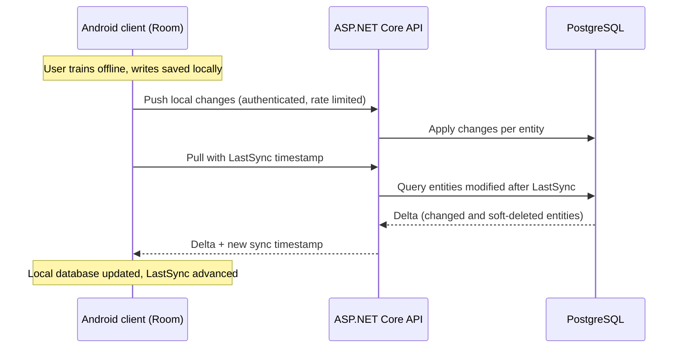

<div align="center">

# FitSync Backend API

**Offline-first synchronization backend for a strength training platform**


</div>

---

## About

FitSync is a strength training platform built around **synchronization, workout tracking and social interactions**. This repository contains the complete production backend used by the mobile client.

> **Note:** The native Android application *(Kotlin + Jetpack Compose + Room DB)* remains private for commercial monetization purposes.

## The Problem

Users train in gyms with poor or no connectivity, yet still expect instant writes, local persistence and seamless access to their data across devices.

FitSync solves this with an **offline-first synchronization engine** that reconciles local and remote datasets through **timestamp-based delta replication**, giving eventual consistency without ever replacing the full dataset.

## Features

| Module | Description |
|---|---|
| **Authentication** | JWT authentication with login lockout (brute-force protection) |
| **Synchronization** | Bidirectional push / pull sync engine with delta replication |
| **Workout Tracking** | Sessions, exercises and sets |
| **Routines** | Training template system |
| **Social Layer** | User relations, sharing and social graph synchronization |
| **Measurements** | Body composition tracking |
| **Logging** | Operational event tracking |

## Architecture

```text
Android (Room Database)
          ⇅
 Offline Storage Layer
          ⇅
 Synchronization Engine
          ⇅
  ASP.NET Core Backend
          ⇅
      PostgreSQL
```

### How synchronization works



- **Push:** the client uploads entities modified while offline.
- **Pull:** the client sends its `LastSync` timestamp and receives only entities changed since then.
- **Deletes:** records are soft-deleted, so removals propagate to other devices as part of the same delta.
- **Auth:** the JWT is refreshed during synchronization, so a long offline session does not break the next sync.

## Engineering Highlights

- **Generic synchronization handlers** using delegates (`Func<T, Task<bool>>`), so new entities plug into the pipeline without duplicating sync logic
- **Delta replication** driven by `LastSync` instead of full dataset transfer
- **JWT refresh during synchronization**
- **Login lockout mechanism** against brute-force attacks
- **Rate-limited sync endpoints**
- **Explicit middleware execution order**
- **Soft delete persistence model**
- **Social graph synchronization logic**

## Roadmap

Currently in progress:

- [ ] Push pipeline optimization through batched synchronization processing
- [ ] Synchronization performance improvements for large payloads
- [ ] User relation retrieval optimization
- [ ] Delta propagation refinements for social entities

The pull path already uses delta replication. The push path is being optimized to reduce sequential processing overhead across multiple entities.

## Getting Started

**Prerequisites:** .NET 8 SDK and a running PostgreSQL instance.

```bash
git clone https://github.com/budzowskipiotrek/<repository-name>.git
cd <repository-name>

# Configure the connection string and JWT settings in appsettings.json
# (or via environment variables / user secrets)

dotnet restore
dotnet ef database update
dotnet run
```

## Contact

**Piotrek Budzowski**, Backend / Android Developer

- Email: [piobudzows@gmail.com](mailto:piobudzows@gmail.com)
- LinkedIn: [linkedin.com/in/piobudzows](https://www.linkedin.com/in/piobudzows/)
- GitHub: [github.com/budzowskipiotrek](https://github.com/budzowskipiotrek)
